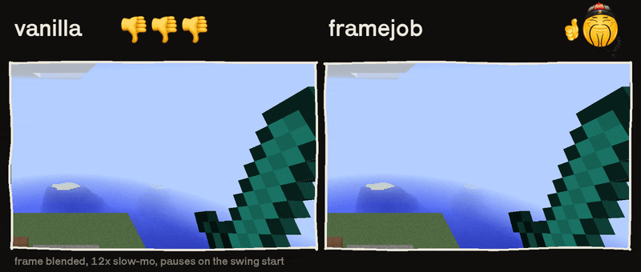
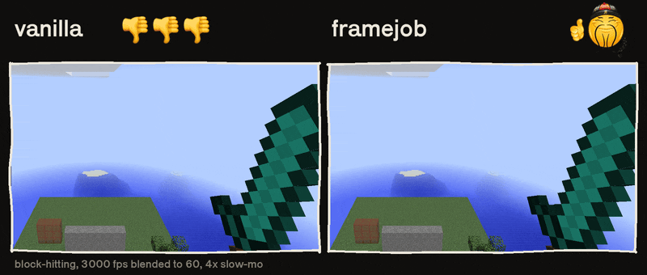

# framejob

smooths swings, block-hits, fov, hand sway and the sneak camera between ticks

## swing start

vanilla bends the arm like this

$$\theta = 80^\circ \sin\left(\pi\sqrt{p}\right)$$

it's infinitely steep at $p = 0$. a swing from rest covers half its angle in the first 8 ms. a blended frame shows the sword twice with a gap in between. framejob eases the first quarter of every swing in, restarts too. the swing still ends when vanilla's does

## spam clicking

clicking again mid swing crams the rest of the swing into one tick. framejob spreads that part over the next few ticks

## block-hitting

1.8.9 only. when you start or stop blocking the sword just teleports into the other pose. right clicking also yanks the hand down in a single frame. framejob moves between the poses and lets the hand dip over a tick instead. we also support [overflowanimations](https://modrinth.com/mod/animations)!!

## fov, hand sway and sneaking

vanilla moves these halfway to their target every tick and draws a straight line in between. they move in little steps. framejob draws the actual curve through the same points like this

$$x(\delta) = x_0 + \left(x_1 - x_0\right) \frac{1 - (1 - k)^\delta}{k}, \quad k = \tfrac{1}{2}$$

where $\delta$ is how far the frame is into the tick. the sneak camera is only on 1.21+

## frame clock

1.21+ only. the game times frames in whole milliseconds. at high fps lots of frames show the same moment. framejob times them in nanoseconds. on 1.8.9 [sarcio](https://modrinth.com/mod/sarcio) already does this

## support

- 1.8.9 on [ornithe](https://ornithemc.net), java 25
- 1.21.1, 1.21.10 and 1.21.11 on fabric, java 21
- 26.1, 26.2 and 26.3 on fabric, java 25

configure in config/framejob.properties, or in [oneconfig](https://modrinth.com/mod/oneconfig) if you're on [oneclient](https://modrinth.com/modpack/oneclient-modpack)
